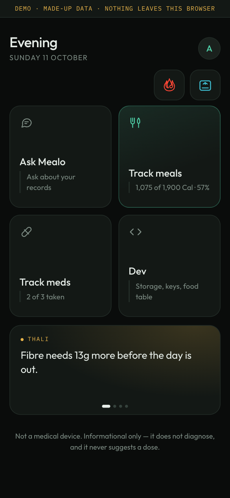

# Mealo

Local-first health tracking: meals, medicines, weight and symptoms in a database
that lives on your device, and one AI chat that looks things up in it.



*The demo build, on a made-up person. Every screen above is a screenshot of the
running app; none of the data is anyone's.*

- **Ask Mealo** is the AI chat. It answers from your own records, through a model
  provider you choose and a key you supply.
- **Thali** (meals) and **Dawa** (medicines) are not AI. They are plain code, so
  every calorie total and every "2 of 4 taken" is arithmetic, not a model's guess.
  Ask Mealo reaches your records only by asking them.

The app works fully without an API key. Tracking, reports, planning a day and
reminders never depend on a model.

---

## What this is not

Read this part first.

- **Not a medical device.** It does not diagnose, and it never suggests, calculates
  or confirms a dose. Not on request, not as an example.
- **Not for emergencies.** If something feels serious, see a doctor or call your
  local emergency number. A message that describes one of a fixed list of
  emergencies is stopped by code and answered with a direction to get care, before
  any model is called. That list cannot cover everything.
- **Not a substitute for a doctor.** A physician-led evaluation of four consumer
  chatbots on 222 patient-posed medical questions found unsafe answer rates between
  5% and 13.5% depending on the model
  ([Draelos et al., *npj Digital Medicine*, 2026](https://doi.org/10.1038/s41746-026-02428-5)).
  This app is built to reduce that — facts come from cited
  sources rather than model recall, and red-flag symptoms are routed by code before
  the model ever sees the message — but it does not eliminate it.
- **Not a cloud service.** There is no account and no server that can read your
  data. If you lose the device and have no backup, the data is gone.

## What it does

**Track.** Meals from your own food table, with portions you weighed once
("1 katori = 150 g") and everything else derived from them; a measured portion
always beats a derived one. Meals can be planned up to a week ahead. Medicines
with their schedules, a sick mode that sets regular medicines aside, and a log of
what was taken, skipped or missed. Weight, daily burn, and symptoms with a history.

**Ask.** Ask Mealo answers questions about what you tracked: "how has my week
looked?", "what did I eat before each time I felt bloated?". It can also start an
entry from a sentence ("I just had 2 roti and dal", "took my morning medicines"),
plan a day ("plan tomorrow so I hit 90 g protein"), and open a report. Each of
those puts a card on screen showing exactly what would be saved. Only your tap
saves it.

**Report.** A report to read, with charts and figures worked out by code, that
prints to PDF; or a plain text file to hand to another AI. Optional AI
observations on the report are switched on by you and checked point by point.

**Remind.** Due medicines and an evening nudge on a day with no meal logged, by
web push, on iPhone and Android.

**Share and keep.** Two phones can share one food table and one medicine library
through an encrypted relay. A backup is the whole database as one file; restore
checks it, shows what it holds beside what the phone holds, and keeps a copy of
what it replaces.

## How the AI is kept honest

Four rules, each built so that it holds whatever a model does.

1. **Code works out the numbers; the AI explains them.** Ask Mealo looks things up
   through eleven tools, all views over the same collected record the reports are
   built from, so a figure in an answer and in a report is one figure. After the
   model answers, any sentence quoting a figure that appears in nothing it was
   given is removed, and the screen says so.
2. **The AI suggests; the person confirms.** No tool writes. None takes a dose, an
   amount, a target or a weight, so there is nothing for a model to fill in. A
   sentence in which a model claims to have saved something is removed.
3. **Checks before the AI, filters after.** Emergencies, disordered eating and
   extreme goals, a change to a medicine, and a request for a diagnosis are each
   stopped in code with a fixed message, before any model is called and for
   someone who never set one up. Dosing instructions are removed from what a
   model says. Identifiers are stripped from everything sent to a provider.
4. **Nothing that decides about the body.** No diagnosis, no dose, no target set
   for you.

And one learned the hard way: **whether something gets logged never depends on a
model choosing to help.** A real model, given "I just had 2 roti and dal" and a
tool for the meal card, ignored the tool and answered "Meals logged" with nothing
logged. So the app reads such sentences itself and opens the card with no model
involved. Planning a day works the same way: the app builds it, only from meals
you logged whole in the last four weeks with the amounts you logged, and says how
far it is from what you asked. It does not stretch a portion to reach a figure.

Thresholds in the safety gates are quoted from a source, not chosen by feel:
a calorie target under 1,000 kcal a day (ICMR-NIN, *Dietary Guidelines for
Indians*, 2011), and weight loss faster than 1.5 kg a week averaged over four
weeks (Weinsier, Wilson and Lee, *Am J Med* 1995). The sources are named at the
top of `src/safety/gates.ts`.

All of this is tested, and the tests are part of the claim:

| Suite | Checks | What it covers |
|---|---|---|
| `npm run test:safety` | 1,156 | the gates, the tools, the numbers and claims checks, the lookup loop, AI insights |
| `npm run test:portions` | 965 | portions, schedules, reports, planning, reminders: all the pure logic |
| `npm run test:e2e` | 463 | the same code against a real SQLite database in a headless browser |
| `npm run test:relay` | 48 | the relay and the reminder sender against a real local D1 |

It still does not make a model safe. It narrows what a model can do wrong here.

## Where your data goes

Your logs live in SQLite in your browser's origin-private file system. When Ask
Mealo needs a model, the app sends the question, a de-identified slice of your
state, and the results of the lookups the model asked for, to whichever provider
*you* configured with *your own* API key. The Dev screen shows the last payloads
that left.

The key identifies you to that provider and carries no data — rotating it never
touches your logs. It is kept in the browser, goes from the browser to the
provider directly, and is never in a backup file.

Two paired devices share a food library and a medicine library. Those travel as
ciphertext through a small relay that cannot read them, because the household key
never leaves the devices. What a person ate, took, weighed or felt does not
travel at all.

For reminders the relay is told the times to ring one browser, and nothing else.
The push it sends is empty; the words on the lock screen are written on the phone.

## Try it

**[mealo-demo.pages.dev](https://mealo-demo.pages.dev)** is the demo, running.
Or on your own machine:

```bash
npm install
npm run dev:demo
```

Either way it is the app with a made-up person in it, 45 days of meals,
three supplements, weights and symptoms, so every screen has something on it.
What you add stays in the browser, and sync and reminders are off. Everything
works without a key. Ask Mealo's answers come through a shared, limited one on
the deployed demo; on your own machine, or once that day's allowance is spent,
they need yours.

## Running it for real

```bash
npm install
npm run dev
```

Then open the printed URL and go to **Dev** on the home screen to configure a
provider.

### Provider setup

Every provider in the list is selectable. The app states each one's data policy
next to the key field and lets you decide — it does not decide for you.

| Provider | Free tier trains on your data? |
|---|---|
| Groq | No — stated across all tiers |
| Together AI | No — not without explicit opt-in |
| Ollama (local) | Nothing leaves your machine |
| Google Gemini | **Yes** on the free tier; human reviewers may read input and output |
| OpenRouter | **Yes** — free models require enabling training *and* prompt publication |

Use the **Test connection** button before anything else. It lists the provider's
models, which is cheap, needs no tokens, and fails in exactly the same way a real
call would — making it a reliable CORS canary.

Not every model calls tools. For one that will not, Ask Mealo falls back to a
fixed summary of your records.

### Local development against Ollama

```bash
ollama serve
ollama pull llama3.1:8b
```

Ollama refuses cross-origin browser requests by default. Set the origin or every
call fails as CORS against your own computer:

```bash
OLLAMA_ORIGINS="http://localhost:5173" ollama serve
```

## Cross-origin isolation

SQLite's OPFS backend requires the page to be cross-origin isolated, so the dev
and preview servers send:

```
Cross-Origin-Opener-Policy: same-origin
Cross-Origin-Embedder-Policy: require-corp
```

**Your deployment host has to send them too.** Without them the app silently falls
back to an in-memory database that loses everything on reload. The This phone
card at the top of the Dev screen says "Not kept on disk" when that happens —
watch it after you deploy.

## Deploying

A Cloudflare Worker serving static assets, free tier; `wrangler.jsonc` is the
whole configuration. The host **must** send the two isolation headers, which is
why `public/_headers` exists and why GitHub Pages is not an option — it cannot
set custom headers at all.

The same Worker is the sync relay and the reminder sender, and it keeps what it
holds in a D1 database, so a deploy needs one of your own:

```bash
npx wrangler d1 create mealo-sync      # prints a database_id; put it in wrangler.jsonc
npx wrangler d1 execute mealo-sync --remote --file=migrations/0001_batches.sql
npx wrangler d1 execute mealo-sync --remote --file=migrations/0002_push.sql
npm run build && npx wrangler deploy
```

`wrangler deploy` uploads whatever is in `dist/` and does not build, so build
first. Connecting the repository in the Cloudflare dashboard (**Workers & Pages**)
instead rebuilds and deploys on every push to `main`.

**Check Dev → This phone on the deployed page before anything else.** If it says
"Not kept on disk", the headers aren't arriving and nothing you log will survive
a reload.

### Reminders

Reminders stay asleep until the Worker has a key pair of its own. Make one on
your own machine and hand it to the Worker; the private key should never be in a
file in the repo or anywhere but wrangler's prompt.

```bash
node scripts/vapid-keys.mjs                 # prints the pair, writes nothing
npx wrangler secret put VAPID_PUBLIC_KEY
npx wrangler secret put VAPID_PRIVATE_KEY
npx wrangler secret put VAPID_SUBJECT       # mailto:you@example.com, or the app's https URL
```

Then turn them on per phone, in **Dev → Reminders**. On an iPhone that needs the
app installed to the Home Screen first.

### The demo

```bash
npx wrangler pages project create mealo-demo --production-branch main   # once
npx wrangler pages secret put AI_KEY --project-name mealo-demo          # once, optional
npm run deploy:demo
```

Static files on Cloudflare Pages, and one small relay (`worker/demo-ai.js`) so
that a visitor can try Ask Mealo without a key of their own. `AI_KEY` is a key
for the relay to use, kept as a secret on Cloudflare and never sent to a
browser. Use a free-tier key from an account with no payment method: the
relay does not count visitors, so the provider's daily allowance is the only
limit, and when it is gone the demo says so and nothing is billed. Without
`AI_KEY` the demo still works, and Ask Mealo asks the visitor for their own.

Pages and not a second Worker, so that the demo's address
(`<project>.pages.dev`) shares nothing with the address of the app you
actually use. The real app has no such relay and must not get one: there a
key goes from your browser to the provider with nobody in between.

### Installing on iOS

Open the deployed HTTPS URL in Safari → Share → **Add to Home Screen**. It has
to be the deployed URL, not `localhost`, and it has to be Safari — Chrome on iOS
cannot install web apps.

Storage durability improves once installed: browsers weigh user engagement when
deciding whether to grant persistent storage, and an installed app scores higher
than a tab. Back up regularly while Dev → This phone says the browser may clear it.

## Project layout

```
src/
  db/
    migrations.ts  schema, forward-only; every table has id / updated_at /
                   deleted_at from v1
    worker.ts      SQLite in a worker, OPFS with an in-memory fallback
    client.ts      main-thread API
    scope.ts       per-table access, and the rule that a read of one person's
                   records must name the person or it throws
    backup.ts      what a backup must hold before a restore will take it
  domain/          the logic, as plain functions: meals, portions, medicines and
                   doses, weight, targets, reports, sync
    tools.ts       Thali and Dawa as a model sees them: lookups, and cards
    mealplan.ts    a day planned from meals already eaten
    reminders.ts   what rings, when, and what it says
  safety/
    redflags.ts    emergency triage in code, before any model call
    gates.ts       disordered eating and extreme goals, a medicine change, a
                   diagnosis: each stopped in code, thresholds from sources
    dosefilter.ts  removes dosing instructions from what a model says
    numbers.ts     removes a sentence whose figure the model was never given
    claims.ts      removes a model's claim to have saved something
    deidentify.ts  strips identifiers from everything sent to a provider
  llm/
    providers.ts   registry, including each provider's data policy verbatim
    adapter.ts     the single OpenAI-compatible adapter + outbound payload log
    toolloop.ts    runs a model's lookups, three rounds at most
    conversation.ts  stored threads and rolling summaries
  data/            bundled reference data and the drug-label lookups
  demo/            the made-up person; in the demo build only
  lib/             device id, key/value store, household key, file parsing
  profiles/        who is logging
  settings/        persisted provider configuration
  ui/              the screens
worker/
  index.ts         the relay: an append-only log of ciphertext, and the minutes
                   at which to send a phone an empty push
public/
  push-sw.js       turns that push into a reminder, from a list kept on the phone
scripts/           tests (pure logic, safety, real SQLite in a browser, the
                   relay) and the data importers
```

## Design rules

1. The database never leaves the device unless the user exports it.
2. What crosses the network is a de-identified slice, assembled per call.
3. Facts come from sources (openFDA, RxNorm, USDA, Singapore's HSA register),
   not from weights.
4. Fail closed — red-flag triage is code that runs before any model call.
5. No recurring cost to anyone. Bring your own key.
6. Logging friction is the product. Over ten seconds and nothing else matters.

## Bundled data

- `src/data/foods.json`: 329 foods from USDA FoodData Central (public domain).
  A fallback for typed meals; your own food table is what the search lists.
- `src/data/hsa.json`: Singapore's Listing of Registered Therapeutic Products,
  from the Health Sciences Authority under the Singapore Open Data Licence. The
  source and version are recorded in the file.

## Status

Built: meal and medicine tracking, two profiles on one device, encrypted sync of
the shared food and medicine libraries, Ask Mealo with its tools and safety
gates, both reports, planning by chat, reminders, backup and restore, and the
demo. Meal tracking is in daily use.

Open: syncing a person's own records between their devices, a recovery
passphrase, a weekly summary, and reading labels from a photo.
[ROADMAP.md](ROADMAP.md) has the phases and what is left in each.

Built by Upendra Sharma, with Claude, for himself and his partner.

## Licence

MIT — see [LICENSE](LICENSE). The software is provided as is, without warranty.
